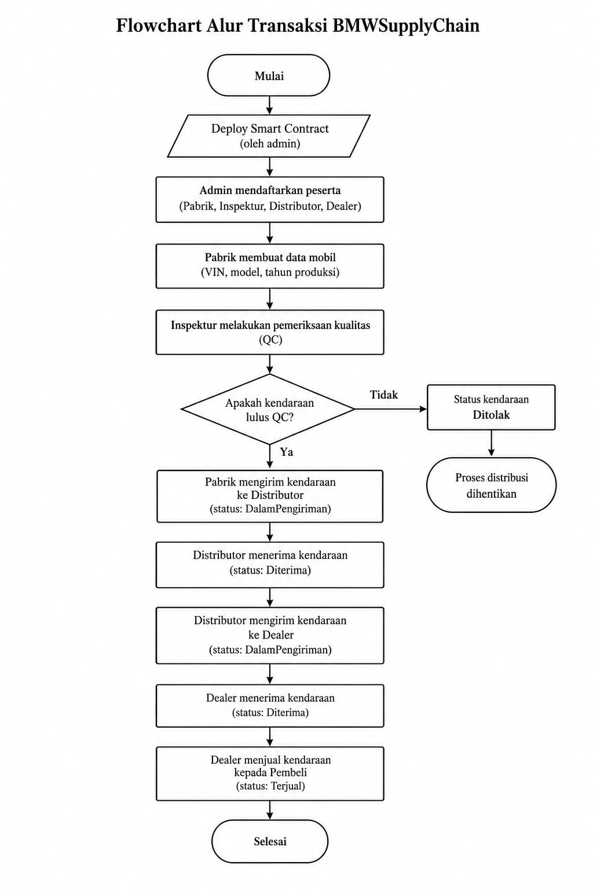

# LAPORAN TUGAS STRUKTUR
**BMWSupplyChain: Sistem Pelacakan Distribusi Mobil BMW Berbasis Blockchain**

* **Mata Kuliah:** Blockchain
* **Program Studi:** Informatika
* **Kelompok:** 3
* **Anggota Tim:**
  1. Nizar Aftana (2530801097)
  2. Wahyu (2530801103)
  3. Wafah Khonia (2530801081)

---

## 1. Latar Belakang dan Solusi Blockchain

### 1.1 Latar Belakang
Rantai pasok atau *supply chain* merupakan rangkaian proses yang menghubungkan produsen dengan konsumen melalui beberapa pihak, seperti pemeriksa kualitas, distributor, dan dealer. Dalam distribusi kendaraan, informasi mengenai identitas kendaraan, hasil pemeriksaan kualitas, pengiriman, serta perpindahan kepemilikan perlu dicatat secara terstruktur agar riwayat kendaraan dapat ditelusuri.

Apabila pencatatan dilakukan secara terpisah oleh setiap pihak, proses pencocokan informasi dan pemeriksaan riwayat kendaraan dapat menjadi lebih sulit. Oleh karena itu, diperlukan sistem yang dapat mencatat aktivitas distribusi dan menerapkan aturan transaksi berdasarkan kewenangan masing-masing pihak.

### 1.2 Solusi yang Diusulkan
Proyek **BMWSupplyChain** merupakan prototipe sistem pelacakan distribusi mobil BMW menggunakan teknologi *blockchain* dan *smart contract* Solidity. Sistem ini dirancang untuk mencatat perjalanan mobil dari pabrik hingga pembeli, dengan tahapan pemeriksaan kualitas atau *Quality Control* (QC), pengiriman ke distributor, penerimaan oleh dealer, dan penjualan kepada pembeli.

*Smart contract* mengatur hak akses berdasarkan peran pengguna, memvalidasi setiap transaksi, serta mencatat aktivitas melalui *event*. Data mobil disimpan menggunakan struktur data `Car`, sedangkan status kendaraan diperbarui sesuai tahapan distribusi.

> **Catatan Integritas Data:** Penggunaan *blockchain* diharapkan meningkatkan keterlacakan dan integritas catatan transaksi. Meskipun demikian, sistem ini merupakan prototipe dan tidak secara otomatis menjamin kebenaran informasi yang dimasukkan oleh pengguna ataupun kondisi fisik kendaraan.

---

## 2. Desain Entitas: Struct dan Mapping

### 2.1 Enum
*Smart contract* menggunakan tiga *enum* utama untuk mengategorikan entitas sistem secara terstruktur:
* **`Role`**: Menentukan peran pengguna, meliputi `None`, `Pabrik`, `Inspektur`, `Distributor`, dan `Dealer`.
* **`ModelBMW`**: Menentukan pilihan model kendaraan, yaitu `Seri3`, `Seri5`, `X5`, dan `iX`.
* **`Status`**: Menunjukkan tahapan kendaraan, yaitu `Diproduksi`, `LulusQC`, `Ditolak`, `DalamPengiriman`, `Diterima`, dan `Terjual`.

*Enum* digunakan agar pilihan data lebih terstruktur dan sesuai dengan kategori yang telah ditentukan dalam program.

### 2.2 Struct Car
*Struct* `Car` digunakan untuk mengelompokkan informasi setiap kendaraan dalam satu struktur data yang komprehensif. Seluruh atribut yang berkaitan dengan satu mobil dikelompokkan dalam satu entitas:

| Atribut | Keterangan |
| :--- | :--- |
| `id` | Identitas mobil dalam sistem |
| `vin` | Nomor identifikasi kendaraan (*Vehicle Identification Number*) |
| `model` | Model kendaraan BMW |
| `tahunProduksi` | Tahun produksi kendaraan |
| `pabrik` | Alamat *wallet* pabrik |
| `pemilik` | Alamat *wallet* pemilik saat ini |
| `penerima` | Alamat *wallet* penerima pengiriman |
| `status` | Status kendaraan dalam rantai distribusi |
| `diperbarui` | Waktu (*timestamp*) terakhir data diperbarui |

### 2.3 Mapping
*Smart contract* menggunakan tiga *mapping* utama untuk menyimpan data *state* di *blockchain*:
* `mapping(address => Role) public roles`: Menghubungkan alamat *wallet* dengan peran pengguna.
* `mapping(uint256 => Car) private cars`: Menghubungkan ID kendaraan dengan data kendaraan berbentuk *struct* `Car`.
* `mapping(bytes32 => bool) private vinTerdaftar`: Menandai apakah *hash* VIN sudah terdaftar sehingga pendaftaran VIN yang sama dapat ditolak.

Kombinasi *struct* dan *mapping* memungkinkan kontrak mengelola data kendaraan berdasarkan ID, memeriksa kewenangan pengguna, serta mencegah pendaftaran ulang VIN yang sama melalui fungsi pembuatan kendaraan.

### 2.4 Aturan Keamanan dan Pencatatan
Validasi transaksi dilakukan secara ketat menggunakan fungsi `require` dan `revert`. Contohnya, hanya admin yang dapat mendaftarkan peserta, hanya inspektur yang dapat melakukan pemeriksaan kualitas, dan hanya penerima yang dituju yang dapat mengonfirmasi penerimaan kendaraan.

*Event* seperti `CarCreated`, `CarInspected`, `CarShipped`, `CarReceived`, dan `CarSold` digunakan untuk menghasilkan log aktivitas terindeks pada *blockchain*. Log tersebut membantu proses pemantauan dan penelusuran riwayat transaksi secara *real-time*.

---

## 3. Flowchart Alur Transaksi

Berikut adalah alur operasional utama dan urutan eksekusi transaksi pada sistem BMWSupplyChain:

Pada setiap tahapan di atas, *smart contract* secara otomatis memeriksa persyaratan transaksi dan kewenangan *wallet* pengirim (`msg.sender`). Jika persyaratan tidak terpenuhi, transaksi akan dibatalkan (*revert*) dan tidak ada perubahan *state* yang disimpan ke *blockchain*.

---

## 4. Kesimpulan

**BMWSupplyChain** merupakan prototipe *smart contract* yang efisien dan aman untuk mencatat serta melacak distribusi kendaraan BMW dari pabrik hingga pembeli akhir. Implementasi struktur data berbasis *enum*, *struct*, dan *mapping* yang dikombinasikan dengan fungsi validasi ketat serta *event logging* berhasil mewujudkan kontrol akses berbasis peran (RBAC) dan transparansi transaksi.

Sistem ini secara signifikan meningkatkan keterlacakan catatan distribusi dan membuktikan efektivitas *smart contract* dalam menyelesaikan masalah fragmentasi data pada rantai pasok. Sebagai langkah selanjutnya, pengembangan dapat diperluas dengan mengintegrasikan verifikasi data fisik IoT/RFID, mekanisme pembayaran aset digital (Oracle/Stablecoin), serta tata kelola hukum operasional di dunia nyata.